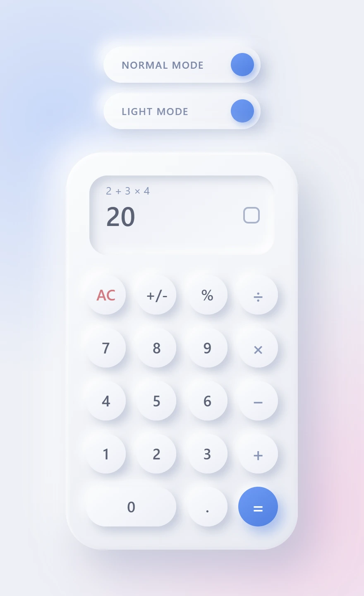
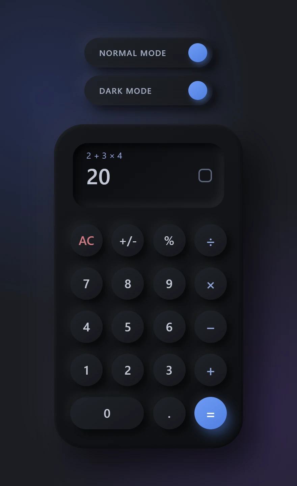
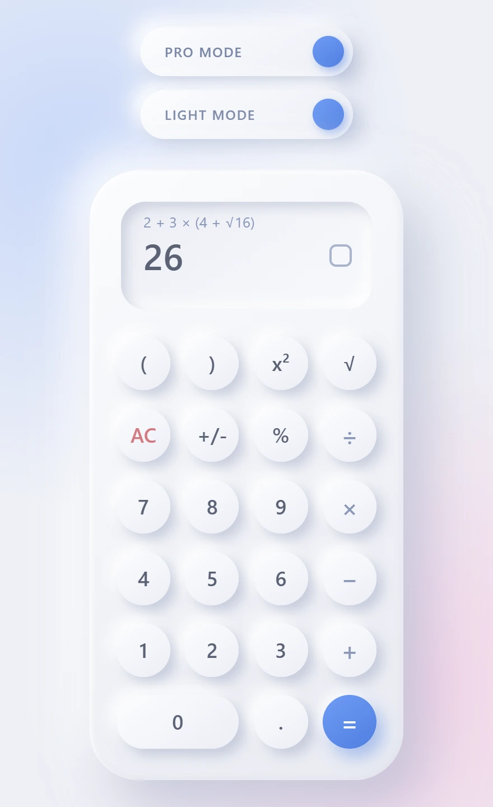
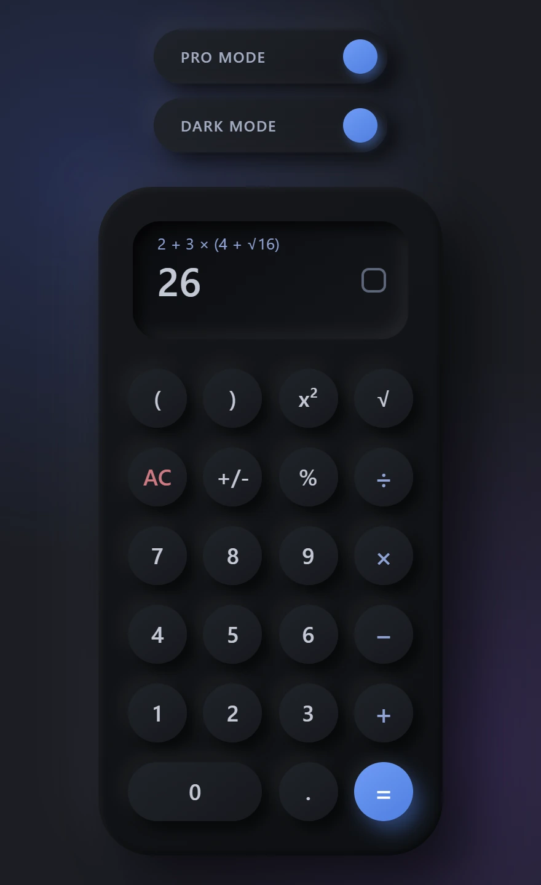

# Neumorphism Calculator

**[Try the Live Calculator](https://neumorphism-calculator-theta.vercel.app/)** · [Screenshots](#screenshots) · [Features](#features) · [Getting started](#getting-started)

A calculator with a soft **neumorphic** interface, written in strict TypeScript with no UI framework. It offers two calculators in one page: a **NORMAL** calculator that evaluates left to right like a classic pocket calculator, and a **PRO** calculator with real operator precedence, parentheses, squares and square roots. Both show the result **live** while you type, and both are fully usable from the mouse or the keyboard.

The project is built as an exercise in clean, testable design: calculation logic is completely separate from the DOM, and the whole thing is covered by an automated test suite.

## Live demo

### [Try the Live Calculator](https://neumorphism-calculator-theta.vercel.app/)

Hosted on Vercel. Switch between NORMAL and PRO, and between LIGHT and DARK, with the two toggles above the calculator; your choice is remembered on that device.

## Screenshots

Real screenshots of the running app. The large display shows the live result before `=` is pressed.

| | LIGHT | DARK |
|---|---|---|
| **NORMAL**<br>`2 + 3 × 4` → `20` (left to right) |  |  |
| **PRO**<br>`2 + 3 × (4 + √16)` → `26` (precedence, parentheses, √) |  |  |

## Features

**Two calculators**
- **NORMAL** evaluates strictly **left to right**: `2 + 3 × 4 = 20`.
- **PRO** follows **mathematical operator precedence**: `2 + 3 × 4 = 14`.
- **Live result preview in both modes:** type `5 + 2` and the large display already shows `7`, with no `=` needed. While you type a single number it is shown exactly as typed (`5.`, `0.50`). An unfinished expression (`5 +`, `(5 + 3`) keeps showing the last valid value instead of an early error.
- **Expression line** above the result shows what was entered (`2 + 3 × 4`, and `2 + 3 × 4 =` once finished). Long expressions scroll and keep the newest part in view.
- Each calculator keeps **its own state** when you switch between them.

**PRO extras**
- Parentheses, including nested ones: `((1 + 2) × (3 + 4)) = 21`.
- Square (`x²`) and square root (`√`).
- Unary minus, including before a group: `5 × -(2 + 3) = -25`.
- Implicit multiplication is made visible: `2(3)` becomes `2 × (3)`.
- Open groups and unfinished input are reported as an `Error` when you press `=`, never silently repaired.

**Shared behavior**
- Digits, decimal point, `+ − × ÷`, `AC`, `+/-` and `%` with contextual percentage rules:

  | Keys | Result |
  |---|---|
  | `50 %` | `0.5` |
  | `200 + 10 % =` | `220` |
  | `200 - 10 % =` | `180` |
  | `200 × 10 % =` | `20` |
  | `200 ÷ 10 % =` | `2000` |

- Numbers are limited to 15 digits. Values keep full precision internally and are rounded only for display, so `0.1 + 0.2 = 0.3`. Integers are exact up to 2^53; larger results use exponent notation (for example `9.999999998e+19`).
- Division by zero, `√` of a negative number and overflow show `Error`; the next digit or `AC` recovers.

**Interface**
- **LIGHT and DARK** themes, switched independently of NORMAL/PRO with two toggles above the calculator, with smooth transitions.
- The chosen **calculator mode and theme are remembered** in `localStorage` (only these two preferences are stored, never the calculation). Invalid or unavailable storage falls back to the defaults. A saved dark theme or PRO mode is applied before the first paint to avoid a flash of the wrong look.
- The large display shrinks its font so long values stay inside it. The layout is fluid and has been checked from about 272 px wide up to desktop widths.

**Keyboard input**

| Key | Action |
|---|---|
| `0`–`9`, `.` | Digits and decimal point |
| `+` `-` `*` `/` | Operators (`-` also starts a negative number in PRO) |
| `Enter` or `=` | Equals |
| `Escape` | `AC` |
| `%` | Percent |
| `(` `)` | Parentheses (PRO only) |

Keys are ignored while typing in a text field and when Ctrl, Cmd or Alt is held, so browser shortcuts keep working. There are no keyboard shortcuts for `x²` and `√`.

## Tech stack

Taken from `package.json`; there are no runtime dependencies.

- **TypeScript 7** in `strict` mode, with unused locals and parameters treated as errors
- **HTML** and **CSS** (CSS custom properties drive both themes)
- **Vite 8** for development and production builds
- **Vitest 5** with **jsdom** for tests

## Architecture

Calculation code never touches the DOM. Rendering, input handling, settings and calculation each live in their own small classes, wired together in one place.

```
src/
├── main.ts                    # entry point
├── calculator/                # calculation logic (no DOM)
│   ├── BasicCalculator.ts     #   interface both calculators implement
│   ├── CalculatorEngine.ts    #   NORMAL rules as state transitions
│   ├── CalculatorState.ts     #   typed state model and display/preview text
│   ├── NormalCalculator.ts    #   engine + the expression entered on it
│   ├── Operator.ts, NumberEntry.ts, NumberFormatter.ts
│   └── pro/                   #   PRO: tokens, evaluator, formatter, calculator
├── classes/                   # CalculatorApp (composition root), InputHandler
├── ui/                        # CalculatorUI (rendering), DisplayFitter
├── settings/                  # CalculatorModeSetting, PreferenceStore, UserPreferences
├── themes/                    # ThemeManager
└── styles/style.css           # layout and both themes
```

| Class | Responsibility |
|---|---|
| `CalculatorApp` | Composition root. Connects input, the active calculator, the UI, the settings and the saved preferences, and owns the start/dispose lifecycle. |
| `BasicCalculator` | The interface (`displayValue`, `expressionText`, digits, operators, `=`, `AC`…) that lets the app drive either calculator the same way. |
| `CalculatorEngine`, `CalculatorState` | NORMAL rules as transitions between typed states (`entering`, `awaitingOperand`, `result`, `error`), including the left-to-right live preview. |
| `NormalCalculator` | Wraps the engine and records the expression for display. It never calculates by itself. |
| `ProCalculator` | Turns key presses into expression tokens and refuses key presses that would build a malformed expression. |
| `ExpressionEvaluator` | A pure recursive-descent parser for PRO expressions (precedence, parentheses, `x²`, `√`, unary minus). No `eval`. |
| `ExpressionFormatter` | Turns tokens into the expression text. |
| `Operator`, `NumberEntry`, `NumberFormatter` | Shared operator table and percent rule, number typing rules, and display formatting. |
| `InputHandler` | Converts clicks and key presses into typed callbacks; removes all its listeners in `dispose()`. |
| `CalculatorUI`, `DisplayFitter` | Render the display, expression line and toggles; shrink the font only when text overflows. |
| `CalculatorModeSetting`, `ThemeManager` | The two independent settings. Neither knows about the other. |
| `PreferenceStore`, `UserPreferences` | Safe `localStorage` access and the two typed, validated preferences. |

## Engineering principles in the code

- **Separation of concerns:** math lives in `calculator/`, rendering in `CalculatorUI`, events in `InputHandler`, persistence in `settings/`. The mode and theme settings are separate classes, and tests check that they import nothing and know nothing of each other.
- **Single responsibility:** each class above has one job, for example `NormalCalculator` only tracks the expression and leaves every number to `CalculatorEngine`.
- **Dependency injection and polymorphism:** `CalculatorApp`, `ProCalculator`, `ThemeManager` and `CalculatorModeSetting` receive their collaborators or initial values through constructors (with defaults), and the app uses NORMAL and PRO interchangeably through `BasicCalculator`. This is what makes the unit tests easy to write.
- **DRY:** both calculators share `Operator.calculate`, the percent rule, number entry rules, number formatting and operator symbols instead of duplicating them.
- **KISS:** no framework and no `eval`; a short recursive-descent parser, and previews are computed from existing state without a second evaluator.
- **Clean code and strictness:** strict TypeScript, discriminated unions for states and tokens, immutable state objects, read-only preview getters that never mutate state, and descriptive comments that explain intent.

Not every SOLID principle is demonstrated formally; the points above are the ones the code actually shows.

## Getting started

**Requirements:** Node.js 22.13 or newer (as required by the current Vite, Vitest and jsdom versions) and npm.

```bash
git clone https://github.com/TamarMosheev/Neumorphism-Calculator-.git
cd Neumorphism-Calculator-
npm install
npm run dev
```

Vite prints the local address (by default <http://localhost:5173/>); open it in your browser.

```bash
npm run build     # type-check with tsc, then build to dist/
npm run preview   # serve the production build locally
npm test          # run the whole test suite once
npx tsc --noEmit  # type-check only
```

## Testing

`npm test` runs the suite once with Vitest. At the time of writing, **1579 tests in 30 files** pass. They cover:

- unit tests for the engine, state model, operators and number formatting;
- the PRO parser, formatter and calculator, including precedence, parentheses, unary minus, percentages, incomplete input and errors, plus randomized "never throws" checks;
- live preview behavior in both modes, and keyboard handling including cleanup of listeners;
- DOM tests, run in jsdom against the real `index.html`, that click the actual buttons and check the display and expression line;
- preference persistence across simulated reloads, including invalid and unavailable storage;
- theme switching and that both themes define the same CSS variables.

Tests live next to the code they cover, in `*.test.ts` files.

## Status

Version 0.1.0. Both calculators, both themes, persistence and keyboard input are working. A live demo and screenshots are available above. No license has been specified.
